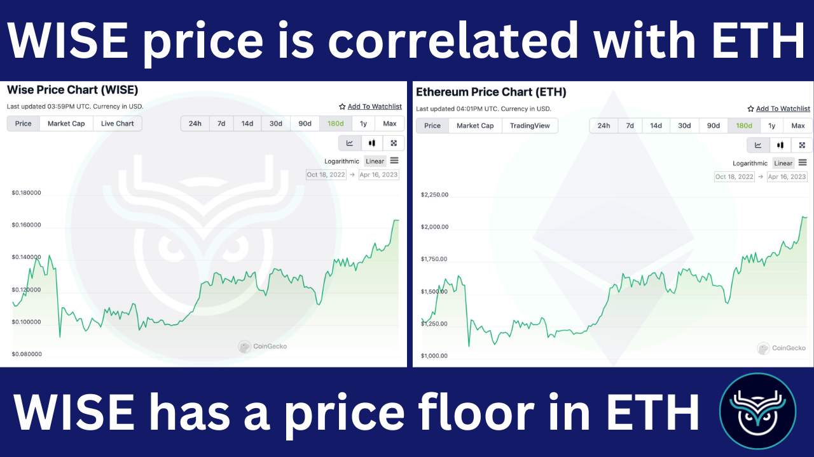
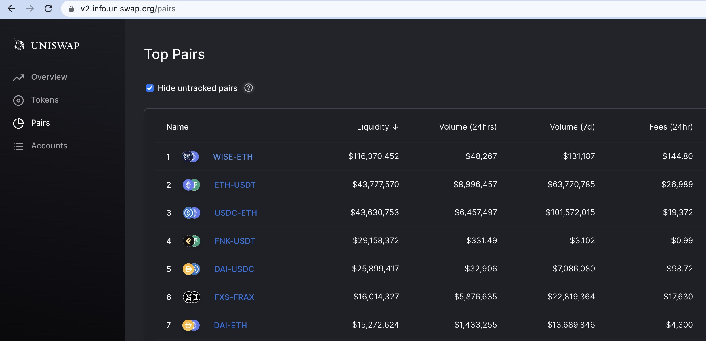

# 🦉⋅WISE Token

WISE functions as the reserve token of our ecosystem, with a significant WISE/ETH liquidity pool on Uniswap that enables other tokens to pair with WISE while maintaining effective conversion paths to ETH.

## WISE Token Launch History:

WISE was launched in November-December 2020 through an [auction event that raised 57,900 ETH](https://legacy.wisetoken.net/reservations) in token sales. Rather than using this ETH for development funding, it was used to establish a WISE/ETH trading pair on Uniswap. The team then [locked this liquidity by burning the LP ownership tokens](https://etherscan.io/token/0x21b8065d10f73ee2e260e5b47d3344d3ced7596e#balances), creating a liquidity foundation that helps support the token's price and trading activity.

Many DeFi tokens rely on high inflation rates to fund airdrops and boost APY on their platforms to attract users and grow TVL. While effective for short-term growth, this approach often creates long-term economic challenges. **WISE has a more measured inflation schedule and a focus on sustainable growth, though like most tokens, it does have larger holders among its user base.**

## WISE as the Reserve token of our Ecosystem:

* **Liquidity -** WISE maintains substantial liquidity on Uniswap to help minimize price slippage for traders. [View WISE liquidity details](https://v2.info.uniswap.org/pair/0x21b8065d10f73ee2e260e5b47d3344d3ced7596e).
* **Distribution -** While many tokens have significant team/insider allocations, WISE launched with a more community-oriented approach. The token distribution is more balanced than many DeFi projects, though concentration among larger holders still exists to some degree, as with most cryptocurrencies. [View token holder distribution](https://etherscan.io/token/0x66a0f676479Cee1d7373f3DC2e2952778BfF5bd6#balances).
* **ETH correlation** - WISE has price correlation with ETH due to the [WISE/ETH liquidity pair on Uniswap](https://v2.info.uniswap.org/pair/0x21b8065d10f73ee2e260e5b47d3344d3ced7596e).
* **Potential for appreciation** - While correlated with ETH, WISE has the potential to appreciate against ETH through the Wise Lending revenue mechanism, which uses protocol fees to buy and burn WISE tokens.

WISE and ETH

As Wise Lending usage grows, the resulting revenue used for WISE token burns may positively impact the token's value. Projects that pair their tokens with WISE instead of ETH could potentially benefit from this mechanism, though such benefits depend on actual adoption and market dynamics.

## WISE Liquidity on Uniswap

WISE/ETH pair on Uniswap V2

## The Vision for WISE in the words of our Founder:

_"We started by collecting Ether from the community and creating a WISE/ETH liquidity pool on Uniswap where we burned the LP tokens to secure the liquidity. This approach gives WISE token a foundation backed by the ETH in the pool. We then developed revenue-generating DeFi applications that use a portion of their fees to buy and burn WISE tokens. As this mechanism continues, we believe WISE may appreciate against ETH, potentially making it attractive for other projects to pair their tokens with WISE. This could create a network effect that benefits the entire ecosystem. By building an open system that focuses on community value rather than concentrating benefits to founders, we're aiming to create a sustainable model that stands apart from traditional approaches."_ Peter Girr
