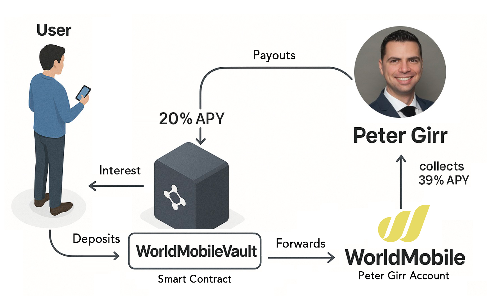
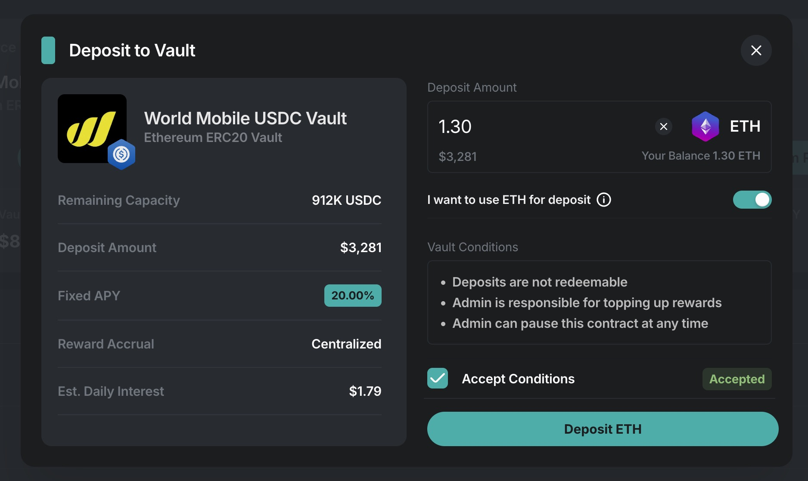
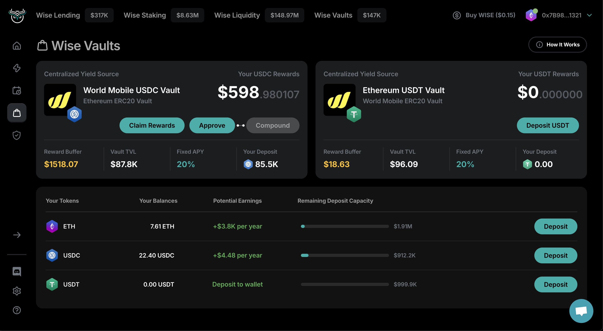
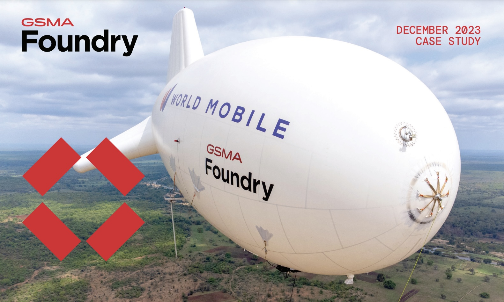

# 📶&nbsp;World Mobile Vault

## Overview

World Mobile is an innovative mobile internet provider that connects underserved populations globally through revolutionary technology. Using a sharing-economy business model similar to how Airbnb transformed hotels and Uber changed taxis, World Mobile delivers reliable internet connectivity at a fraction of traditional costs. Through a strategic partnership with World Mobile, the platform offers a 20% fixed APY vault for USDC deposits.

## World Mobile Vault Features

### 20% Fixed APY Vault

The World Mobile vaults offer a consistent 20% annual percentage yield on USDC, USDT, and ETH deposits. This high-yield opportunity is available through the [https://one.wise.one/vaults](https://one.wise.one/vaults) platform on both Ethereum and Arbitrum networks.

#### Deposit Options

**USDC/USDT Deposits:**
- Require two transactions: one for approval and one for the actual deposit (standard ERC20 token process)

**ETH Deposits:**
- Require only a single transaction (no approval step needed)
- ETH is automatically deposited into the less filled vault between USDC/USDT
- Any vault can also accept ETH during the deposit process

<figure><figcaption>
ETH deposit option in the World Mobile vault interface
</figcaption></figure>

### World Mobile Vault Contracts

#### Ethereum Network

| Contract Name | Address | Blockchain Explorer |
|--------------|----------|--------------------|
| USDC ERC20 Vault | `0x918B7Ce7Bfc40C20aEE5B4c8e9e606a3666779bd` | [Etherscan](https://etherscan.io/address/0x918B7Ce7Bfc40C20aEE5B4c8e9e606a3666779bd) |
| USDT ERC20 Vault | `0xbD53635D938C7Eeb96079dBd890B0e11AB6b003D` | [Etherscan](https://etherscan.io/address/0xbD53635D938C7Eeb96079dBd890B0e11AB6b003D) |

#### Arbitrum Network

| Contract Name | Address | Blockchain Explorer |
|--------------|----------|--------------------|
| USDC ERC20 Vault | `0xfbFE33dA1c71a120cdB75558EFF8164Ee5860167` | [Arbiscan](https://arbiscan.io/address/0xfbFE33dA1c71a120cdB75558EFF8164Ee5860167) |
| USDT ERC20 Vault | `0xcDC4Ca5C30256ECb6F473B37e3c2A9a9a4e934F9` | [Arbiscan](https://arbiscan.io/address/0xcDC4Ca5C30256ECb6F473B37e3c2A9a9a4e934F9) |

### How It Actually Works

When users deposit USDC/USDT into the World Mobile vault, the following process takes place:

1. The deposited funds are forwarded to the internal account of Admin (Peter Girr), who acts as a partner of World Mobile for this arrangement
2. These funds are then used to purchase AirNodes through Admin's account
3. The AirNodes generate revenue from World Mobile's operations
4. The interest earned on these nodes is collected by the Admin (Peter Girr)
5. The Admin (Peter Girr) then deposits fractions of the revenue back into the vault to cover 20% APY
6. Users can claim their proportional rewards based on their ERC20 receipt token holdings

It's important to understand that the initial principal is not withdrawable directly from the vault, as it has been used to purchase physical infrastructure. However, users can sell their ERC20 receipt tokens on secondary markets if they wish to exit their position.

**Important Notes:**
- Users receive ERC20 receipt tokens representing their deposit positions
- There are four separate vaults, each capped at $1M:
  - USDC vault on Ethereum
  - USDT vault on Ethereum
  - USDC vault on Arbitrum
  - USDT vault on Arbitrum
- ETH deposits are accepted in all vaults and automatically routed to the less filled vault
- Early participation is recommended as the vaults fill quickly
- Vault caps expand only as World Mobile's capacity grows
- Receipt tokens can be freely traded on secondary markets

<figure><figcaption>
World Mobile ERC20 positions dashboard
</figcaption></figure>

### Position Management

#### Collecting Rewards
Interest accrues immediately after USDC principal is deposited and can be claimed at any time. Each position displays a **Collect Rewards** button that allows for interest claiming. The amount of rewards is proportional to the amount of ERC20 receipt tokens held.

#### Transferring Positions to Other Wallets or DeFi Protocols

Positions are represented by standard ERC20 receipt tokens that can be transferred like any other token. Users can send these tokens to other wallets, use them in DeFi protocols, or trade them on decentralized exchanges.

#### Principal Liquidity
USDC principal cannot be withdrawn directly as it funds the purchase of World Mobile network infrastructure. However, positions can be sold on secondary markets. When USDC is deposited, ERC20 receipt tokens representing the position are minted to the depositor's wallet. These tokens are essential for claiming interest and can be easily traded on secondary markets or used in other DeFi protocols.

The ERC20 standard makes these positions highly liquid and compatible with existing decentralized exchanges and liquidity pools. Historically, node positions have traded above their purchase price due to the attractive APY. The Wise team provides assistance to users looking to exit their positions if needed.

### Security Measures and Fund Flow

The World Mobile vault employs several security features and follows a specific fund flow:

1. Immediate forwarding of deposits to Peter Girr's account as the World Mobile partner
2. Peter Girr uses these funds to purchase AirNodes for the World Mobile network
3. Insurance coverage for all node infrastructure as part of the node cost
4. Complete maintenance handled by World Mobile
5. Revenue generated by the nodes is collected by the admin
6. Admin deposits 20% of the revenue back to the vault for user claims

Users are encouraged to claim interest monthly to minimize exposure to potential (though unlikely) exploits targeting incoming revenue. The admin is responsible for ensuring that the 20% revenue share is consistently deposited back to the vault for distribution to token holders.

### Admin Functions and Adjustable Parameters

The World Mobile vault contracts include several admin-controlled functions that can be modified as needed. These functions can only be executed by the designated admin (Peter Girr) and include:

#### Specific Admin Functions

| Function | Description | Parameters Admin Can Change |
|----------|-------------|-----------------------------|
| `depositRewards(uint256 amount)` | Deposits rewards into the vault to maintain the 20% APY | Amount of USDC/USDT to deposit as rewards |
| `setVaultCap(uint256 newCap)` | Adjusts the maximum capacity of each vault | New cap amount (currently $1M per vault) |
| `pauseDeposits(bool paused)` | Enables/disables new deposits to the vault | Boolean toggle (true/false) |
| `setFeePercentage(uint256 newFee)` | Modifies the fee structure for the vault | New fee percentage (basis points) |
| `upgradeContract(address newImplementation)` | Implements contract upgrades for security or features | Address of new implementation contract |
| `setRewardRate(uint256 newRate)` | Adjusts the APY rate for the vault | New APY rate (currently 20%) |
| `whitelistAddress(address user, bool status)` | Controls which addresses can interact with the vault | User address and boolean status |
| `emergencyWithdraw(uint256 amount)` | Allows emergency withdrawal in critical situations | Amount to withdraw |
| `setMinimumDeposit(uint256 amount)` | Sets minimum deposit threshold | Minimum deposit amount |
| `setMaximumDeposit(uint256 amount)` | Sets maximum deposit per transaction | Maximum deposit amount |

#### When Admin Functions Are Typically Used

* **Reward Distribution**: Monthly deposits to maintain the promised 20% APY
* **Vault Cap Adjustments**: When World Mobile expands infrastructure capacity
* **Emergency Controls**: Only in case of security threats or critical market conditions
* **Fee Structure Changes**: Rarely modified, only if operational costs significantly change
* **Contract Upgrades**: Scheduled maintenance or security improvements

All admin actions are transparent and can be verified on the blockchain through transaction history. The admin is contractually obligated to maintain the promised 20% APY for all vault participants.

## World Mobile Technology

### Aerostat Innovation

World Mobile has revolutionized internet infrastructure deployment by using aerostats (blimps) instead of traditional cell towers. A single 75-foot tethered blimp carrying radio transmitters can replace up to 12 conventional cell towers. This technology:

- Reduces infrastructure costs by 8x compared to traditional methods
- Enables rapid deployment in previously underserved areas
- Connects to rooftop air nodes to provide internet to households and mobile devices
- Continues to improve in efficiency and cost-effectiveness

For detailed technical information, see the [latest industry study](https://www.gsma.com/get-involved/gsma-foundry/wp-content/uploads/2023/12/New-Coverage-Takes-to-the-Skies-b-FINAL.pdf) on this technology.

### Sustainable Business Model

Internet connectivity has become an essential utility in modern society, comparable to food and housing in terms of consumer priority. World Mobile's business model is particularly resilient because:

- Services are priced affordably (under $2 monthly in developing regions)
- Customer contracts roll annually, securing revenue streams
- Infrastructure costs are significantly lower than industry standards
- The technology serves both developed and developing markets

This sustainable model enables the consistent 20% fixed yield offered through the vault, with potential for even higher returns as operational efficiency increases.

### APY Stability Factors

The 20% fixed APY is supported by several factors:

1. Direct revenue flow from World Mobile's operations
2. Annual rolling contracts that provide revenue predictability
3. World Mobile's significant cost advantage (8x) over traditional providers
4. Established market presence and trusted partnerships

The Wise team is committed to maintaining the 20% fixed APY as long as World Mobile continues delivering this value. The ERC20 token format enables users to easily trade their positions on decentralized exchanges, creating natural liquidity. Additionally, if needed, the Wise team will assist by selling nodes to maintain liquidity in the ecosystem.

## Market Potential

World Mobile's market opportunity is substantial:

- Over 30% of the global population lives in developing or emerging regions ideal for World Mobile's technology
- Aerostat deployment is possible in most geographic areas, enabling wide coverage
- Current operations include underserved areas in developed nations, such as Reno, Nevada
- Growth limitations are primarily regulatory rather than technological

With its innovative approach and cost advantages, World Mobile has the potential to become one of the largest internet carriers globally.

## World Mobile vs. Starlink

A common misconception is that Starlink and similar satellite internet providers compete directly with World Mobile. In reality:

- Starlink complements World Mobile's infrastructure, with Starlink nodes often used on World Mobile aerostats
- Satellite and terrestrial internet technologies serve different purposes due to fundamental physics constraints
- Satellites excel at providing basic connectivity in extremely remote areas but face limitations in high-density population centers
- Ground-based infrastructure like World Mobile's is necessary for high-bandwidth streaming and data-intensive applications for multiple users in proximity
- Satellite bandwidth faces inherent limitations from "beam contention" and high operational costs

World Mobile's solution provides high-bandwidth internet at affordable rates (under $2 monthly) in developing regions, addressing needs that satellite internet alone cannot satisfy.

## Additional Resources

Watch the informational video about World Mobile for more details on the technology and partnership.
